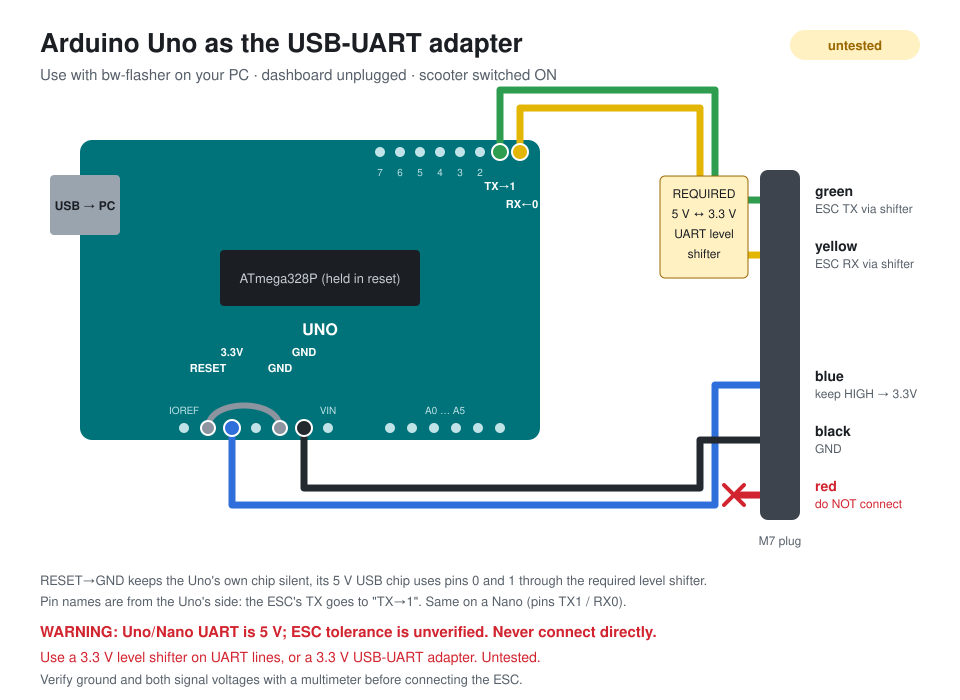

# bw-esp32-flasher

**Flash a Brightway scooter controller (e.g. Xiaomi Electric Scooter 5) with an ESP32 or an Arduino
you already have. You don't need to buy a USB-UART dongle.**

Brightway ESCs are flashed over the dashboard cable with
[ScooterTeam bw-flasher](https://github.com/scooterteam/bw-flasher). Most guides tell you to buy a
USB-UART adapter for this. You can do the same job with:

- **an ESP32 on its own.** This repo puts the whole flasher on the ESP32, so the PC only copies files.
- **an Arduino Uno/Nano used as the adapter** for bw-flasher on your PC.

The repo also has a **wire probe**. Cable colours often don't match the guides, and a wrong wire
was the reason our first evening of flashing failed.

Make the firmware image with [bw-patcher](https://github.com/scooterteam/bw-patcher) as usual.

## Pick your setup

| Setup | You need | Status |
|---|---|---|
| **A. ESP32 alone** (this repo) | any ESP32-WROOM-32 dev board | ✅ tested: Xiaomi Scooter 5, full flash in 251 s |
| **B. Arduino Uno / Nano as adapter** + bw-flasher | Uno or Nano, 1 extra jumper wire | ⚠️ untested |
| C. USB-UART dongle + bw-flasher | CH340/CP2102 adapter | ✅ works (the usual way) |

All setups need a cable to the ESC's dashboard connector and some Dupont jumper wires.

## A. ESP32 alone


1. **Install MicroPython on the ESP32** (once). Download the
   [ESP32_GENERIC](https://micropython.org/download/ESP32_GENERIC/) image, then:
   ```
   pip install esptool mpremote
   esptool --chip esp32 erase_flash
   esptool --chip esp32 write_flash -z 0x1000 ESP32_GENERIC-<version>.bin
   ```
2. **Copy the files**, together with your patched firmware renamed to `fw.bin`:
   ```
   mpremote cp esp32/bwflash.py :bwflash.py + cp esp32/probe.py :probe.py + cp esp32/main.py :main.py + cp patched.bin :fw.bin
   mpremote reset
   ```
   `main.py` holds GPIO17 high from power-up, so the ESC doesn't switch off when you connect the blue wire.
3. **Wire it up** as in the picture. Unplug the dashboard and switch the scooter on.
   Not sure which wire is which? See [Identify the wires](#identify-the-wires).
4. **Check the connection.** This only reads from the ESC:
   ```
   mpremote exec "import bwflash; print(bwflash.info())"
   ```
   You should see the UID and the current version, e.g. `(b'Lspd…', '0015')`.
5. **Flash.** It takes about 4 minutes. Don't touch the cable or the power button while it runs.
   ```
   mpremote exec "import bwflash; bwflash.flash('fw.bin')"
   ```
   It ends with `verify OK`, `firmware update completed` and the new version.

Pins can be changed at the top of `esp32/bwflash.py` (`TX_PIN`, `RX_PIN`, `KEEP_PIN`). The ESP32
needs no extra parts: the pull-up for the ESC's open-collector TX line is switched on inside the chip.

## B. Arduino Uno / Nano as the adapter



An Uno has too little memory to hold the firmware (32 KB, while the image is ~140 KB). But its USB
chip is a USB-UART adapter. Connect **RESET to GND** to keep the ATmega silent. Pins 0 and 1 then go
straight to the USB chip, and bw-flasher on your PC uses the Uno's serial port like any dongle.

1. Wire as in the picture: RESET–GND jumper, ESC TX → `TX→1`, ESC RX → `RX←0`, keep-alive → 3.3V, GND.
   On a Nano, use the pins labelled TX1 / RX0.
2. Plug the Uno into the PC and run bw-flasher on its port (`/dev/ttyACM0`, `/dev/ttyUSB0` or `COMx`).

**This setup has not been tested yet.** If you try it, please open an issue with the result.

## Identify the wires

We used a female M7 5-pin cable sold for the 3 Lite / 4 Lite. Its colours did **not** match the M7
table in the ScooterTeam guide:

| | ScooterTeam M7 table | our cable (measured) |
|---|---|---|
| GND | yellow | **black** |
| ESC RX | white | **yellow** |
| ESC TX | green | green |
| BTN / keep-alive | black | **blue**: if it floats, the ESC switches off |
| power | red 5V | red: **never connect** |

With the wrong mapping the ESC never answers. The flasher shows empty responses to `53 2A 7D AC`
([bw-flasher #32](https://github.com/scooterteam/bw-flasher/issues/32) shows the same symptom).
So probe the wires first, using an ESP32 with MicroPython and `probe.py` copied to it:

1. Connect ESP32 GND to the wire you think is ground.
2. Connect every other unknown wire to a free GPIO, e.g. 4, 16, 17, 18. **Leave out any wire that
   could carry battery voltage.** The ESP32 is a 3.3 V part.
3. Run:
   ```
   mpremote exec "import probe; probe.run((4, 16, 17, 18))"
   ```

| Probe says | Wire is | Connect to |
|---|---|---|
| `ESC TX (… status frames)` | ESC TX | ESP32 RX pin (GPIO16) |
| `held high even with pull-down` | ESC RX (has its own pull-up) | ESP32 TX pin (GPIO5) |
| `held low even with pull-up` | ground | GND |
| `floating` and the scooter switches off | keep-alive line | GPIO17 (held high) |

## Troubleshooting

| Symptom | Likely cause |
|---|---|
| `no answer at step UID` / empty responses to `53 2A 7D AC` | Wrong wire on ESC RX or GND. Run the probe. |
| Scooter switches off when you connect the cable | Keep-alive (blue on our cable) is floating. Hold it high. |
| RX gets only zeros or broken frames | No pull-up on the ESC TX line. Use GPIO16 (pull-up set by the code) or add 4.7–10 kΩ to 3.3 V. |
| `BLE_KEY does not match` | The image is not for this ESC. |
| Sparks between two wires | You shorted power to ground. Stop: red is not a signal wire. |

## How it works

`esp32/bwflash.py` is a port of bw-flasher's `brightway_flasher.py`, `keygen.py` and `xmodem.py` to
MicroPython. The steps are:

1. UID, then `get_ver`, then `rd_info`.
2. The `ble_rand` / `mcu_rand` / `mcu_key` challenge.
3. 2 KiB `nvm_write` packets, sent as 128-byte XMODEM-CRC frames.
4. `wr_info` with a CRC-32, then `dfu_verify` and `dfu_active`.

The image is streamed from the ESP32's filesystem, so it doesn't have to fit in RAM.

`tests/test_bwflash.py` runs both this port and the original bw-flasher against a fake ESC. It checks
that the image arrives byte for byte and that both flashers send identical traffic:

```
BW_FIRMWARE=patched.bin BW_FLASHER_SRC=path/to/bw-flasher python -m pytest -q tests
```

## Risks

Flashing ESC firmware can brick the controller. Use only images made for your exact model and keep
the stock image. Recovery from an interrupted flash has not been tested with this project.

## License and credits

The protocol, key generation and flashing sequence come from
[ScooterTeam bw-flasher](https://github.com/scooterteam/bw-flasher) (commit `8baeea1`), licensed
CC BY-NC-SA 4.0. This port uses the same license: see [LICENSE](LICENSE). Non-commercial use only.
