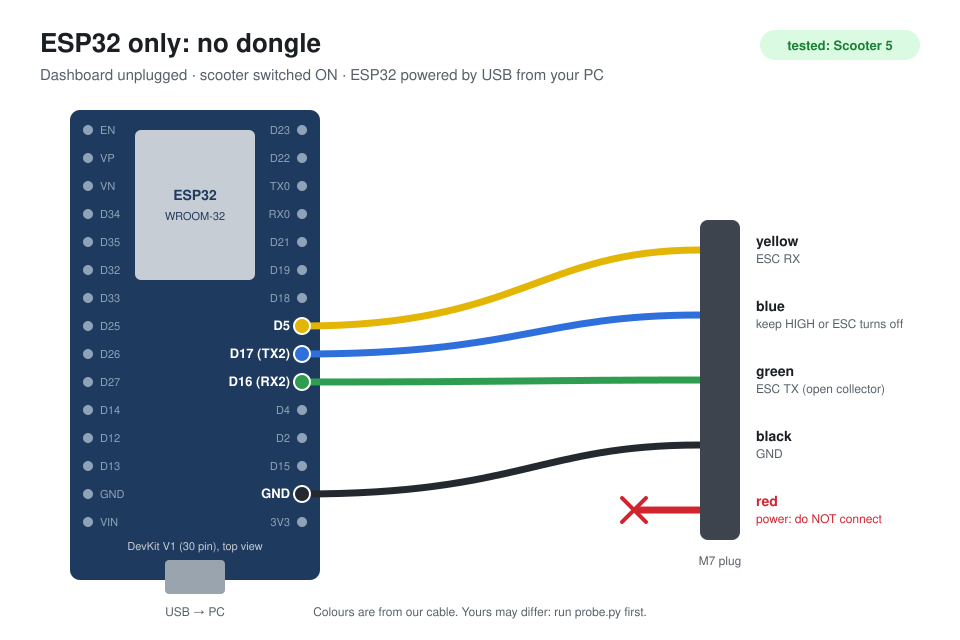

# bw-esp32-flasher

**Flash a Brightway or LEQI scooter controller (e.g. Xiaomi Electric Scooter 5) with an ESP32 or an Arduino
you already have. You don't need to buy a USB-UART dongle.**

Brightway and LEQI ESCs are flashed over the dashboard cable with
[ScooterTeam bw-flasher](https://github.com/scooterteam/bw-flasher). Most guides tell you to buy a
USB-UART adapter for this. You can do the same job with:

- **an ESP32 on its own.** This repo puts the whole flasher on the ESP32, so the PC only copies files.
- **an Arduino Uno/Nano used as the adapter** for bw-flasher on your PC.

The repo also has a **wire probe**. Cable colours often don't match the guides, and a wrong wire
was the reason our first evening of flashing failed.

Make the firmware image with [bw-patcher](https://github.com/scooterteam/bw-patcher) as usual.

## Pick your setup

| Setup | You need | Status |
|---|---|---|
| **A. ESP32 alone** (this repo) | any ESP32-WROOM-32 dev board | ✅ tested: Xiaomi Scooter 5, full flash in 251 s |
| **B. Arduino Uno / Nano as adapter** + bw-flasher | Uno or Nano, 1 extra jumper wire | ⚠️ untested |
| **C. Phone only (Wi-Fi)** | ESP32-WROOM-32, powerbank, phone | ✅ tested with a PC as the Wi-Fi client: full flash on a Xiaomi 5; phone browsers untested |
| D. USB-UART dongle + bw-flasher | CH340/CP2102 adapter | ✅ works (the usual way) |

All setups need a cable to the ESC's dashboard connector and some Dupont jumper wires.

## C. Phone only (Wi-Fi)

After a one-time USB installation, the ESP32 needs only power. The phone connects directly
to its access point; no internet, app, CDN or desktop computer is needed during use.
Tested on a real ESP32 and Xiaomi 5 with a PC as the Wi-Fi client: 141 KB upload in 3.4 s, preflight,
connection check and a full flash (69/69 packets, verify OK). **The page has not been tried on Android
Chrome or iPhone Safari yet.**

**The board turns its Wi-Fi off while it flashes (about 4 minutes).** With the radio on, about 1 in 20
replies from the ESC lost a byte in our measurements, and the first Wi-Fi flash attempt was
rejected by the ESC at packet 1. With the radio off, every read and both full flashes were clean.
Your phone may switch to another network meanwhile: rejoin `bw-flasher-XXXX` afterwards to see the result.
The connection check reads the ESC until two replies agree, for the same reason.

1. Install **MicroPython 1.29 / ESP32_GENERIC** once (see setup A below). Copy all files:
   ```
   mpremote cp esp32/bwflash.py :bwflash.py + cp esp32/leqiflash.py :leqiflash.py + cp esp32/flasher.py :flasher.py + cp esp32/probe.py :probe.py + cp esp32/webui.py :webui.py + cp esp32/webui.html :webui.html + cp esp32/main.py :main.py
   mpremote reset
   ```
   If previously using USB-only mode, remove `webui.disabled` via the REPL before resetting.
   An out-of-box ESP32 still needs this initial installation; a turnkey installer is a later task.
2. Power the board from a powerbank. Join **`bw-flasher-XXXX`** (last two AP MAC bytes).
   The default WPA2 password is **`bw-flasher-setup`**. Change `AP_PASSWORD` in `webui.py`
   before copying if other people could be nearby. Stay on this Wi-Fi when the phone warns
   that it has no internet, then open **http://192.168.4.1** in the regular browser.
3. Follow the page's wiring guide. Select **Brightway** or **LEQI** for your controller and
   tap **Check connection**. It reads Brightway UID/version or LEQI version/region.
   LEQI does not supply a UID through this command. No invented fault-code interpretations are shown.
4. Select your patched raw **`.bin`** from the phone and tap **Upload and inspect**.
   The board streams it to disk in chunks of at most 1024 bytes and checks free space first.
   Limit: **4 KiB–512 KiB**; ZIP/TEA containers are unsupported. Family preflight runs before
   promotion from the temporary file. Read family, size and model ID (when present).
   A model ID is informational: it does **not** prove compatibility with your scooter.
5. Tap **Review flash**, check compatibility and stable power, then **Confirm and flash controller**.
   Only one upload, connection check, probe or flash runs at a time. The page shows packet n/N;
   reaching N/N still requires finalization. Wait for the final success or actionable error.
   **Keep both power supplies connected and do not touch the wires or scooter power button.**
   The Wi-Fi goes off during the flash and the board continues on its own. Rejoin Wi-Fi and reopen the page to read
   progress/result. State lasts until the next operation or ESP32 restart, not across power loss.
6. If the connection fails, use the **wire probe wizard**. Measure wires first: never connect
   power/battery voltage to GPIOs. Select 1–6 supported GPIOs. The page explains each verdict;
   an ambiguous high/floating/activity reading is not a definitive wire identification.
   Probing can interrupt keep-alive and switch off the scooter. GPIO17 is restored high afterward;
   restore normal wiring and check the connection again before flashing.

**USB-only opt-out:** create a flag before reset:
```
mpremote exec "open('webui.disabled', 'w').close()"
mpremote reset
```
Delete it with `mpremote exec "import os; os.remove('webui.disabled')"` and reset to enable Wi-Fi.
Alternatively hold BOOT/GPIO0 low when `main.py` starts after reset; on classic ESP32, holding
BOOT throughout a power-on reset enters the ROM downloader instead, so the flag is the reliable
REPL opt-out. GPIO17 is held high before starting the UI. Ctrl-C over USB can interrupt the server;
use the flag for routine USB work. Never reset or interrupt the board during a flash.

The HTTP API exposes only fixed paths, with bounded headers/control bodies and raw uploads;
it accepts no client-supplied filesystem path. Browser writes require a per-boot token and same-origin
requests. WPA2 protects the radio link; HTTP is local and has no separate user accounts or TLS.
Anyone with the AP password can control the board. There is no upstream Wi-Fi connection or telemetry.
Interrupted uploads are discarded; a previous image is never overwritten by a partial/invalid upload.
After reboot, upload and check the controller again before flashing (old on-disk images are not auto-selected).
If disk space is exhausted, remove unused files via USB; the phone does not offer arbitrary file deletion.

## Supported models

Families and required dashboard cables follow the
[ScooterTeam guide](https://wiki.bastelpichi.de/brightway.html#supported-models) and its
[connector table](https://wiki.bastelpichi.de/brightway.html#step-1-check-your-scooters-connector-type).
Connector gender below describes the required cable. All models are Xiaomi Electric Scooters.
Upstream compatibility does not establish ESP32 hardware compatibility.

| Model | Family | Dashboard cable | ESP32 status |
|---|---|---|---|
| 3 Lite | Brightway | male M7 5-pin | untested with ESP32 |
| 4 | Brightway | male M7 5-pin | untested with ESP32 |
| 4 Lite | Brightway | male M7 5-pin | untested with ESP32 |
| 4 Ultra | Brightway | male M7 5-pin | untested with ESP32 |
| 4 Pro 2nd Gen | Brightway | female M7 5-pin | untested with ESP32 |
| 5 | Brightway | female M7 5-pin | tested |
| 5 Pro | Brightway | male M7 5-pin | untested with ESP32 |
| 5 Max | Brightway | male M7 5-pin | untested with ESP32 |
| 4 Lite 2nd Gen | LEQI | male M8 5-pin | untested with ESP32 |
| 5 Plus | LEQI | male M8 7-pin | untested with ESP32 |
| 5 Elite | LEQI | male M8 5-pin | untested with ESP32 |
| 6 | LEQI | male M8 5-pin | untested with ESP32 |
| 6 Lite | LEQI | male M8 5-pin | untested with ESP32 |

LEQI has only synthetic host-side verification against upstream; no LEQI hardware or real
LEQI image has been tested here. The guide marks 4 Lite 2nd Gen and 5 Plus as TBA;
listing a family and cable does not guarantee an available or compatible patched image.

## A. ESP32 alone



1. **Install MicroPython on the ESP32** (once). Download the
   [ESP32_GENERIC](https://micropython.org/download/ESP32_GENERIC/) image, then:
   ```
   pip install esptool mpremote
   esptool --chip esp32 erase_flash
   esptool --chip esp32 write_flash -z 0x1000 ESP32_GENERIC-<version>.bin
   ```
2. **Select USB-only mode** (the Wi-Fi UI is the default with the full installation above):
   ```
   mpremote exec "open('webui.disabled', 'w').close()"
   ```
   **Copy the files**, together with your patched firmware renamed to `fw.bin`:
   ```
   mpremote cp esp32/bwflash.py :bwflash.py + cp esp32/leqiflash.py :leqiflash.py + cp esp32/flasher.py :flasher.py + cp esp32/probe.py :probe.py + cp esp32/webui.py :webui.py + cp esp32/webui.html :webui.html + cp esp32/main.py :main.py + cp patched.bin :fw.bin
   mpremote reset
   ```
   `main.py` holds GPIO17 high from power-up, so the ESC doesn't switch off when you connect the blue wire.
3. **Wire it up** as in the picture. Unplug the dashboard and switch the scooter on.
   Not sure which wire is which? See [Identify the wires](#identify-the-wires).
4. **Check the connection.** For Brightway, this only reads from the ESC:
   ```
   mpremote exec "import bwflash; print(bwflash.info())"
   ```
   You should see the UID and the current version, e.g. `(b'Lspd…', '0015')`.
   For LEQI use `mpremote exec "import leqiflash; print(leqiflash.info())"`;
   it returns `(version, region)` from the read-only DeviceInfo command.
5. **Flash.** The image selects the family automatically. Brightway on our Xiaomi 5 takes about 4 minutes. Don't touch the cable or the power button while it runs.
   ```
   mpremote exec "import flasher; flasher.flash('fw.bin')"
   ```
   Brightway ends with `verify OK`, `firmware update completed` and the new version.
   LEQI ends with `LEQI firmware update completed`; it has no separate verify command.

Pins can be changed at the top of `esp32/bwflash.py` (`TX_PIN`, `RX_PIN`, `KEEP_PIN`). The ESP32
needs no extra parts: the pull-up for the ESC's open-collector TX line is switched on inside the chip.

## B. Arduino Uno / Nano as the adapter


An Uno has too little memory to hold the firmware (32 KB, while the image is ~140 KB). But its USB
chip is a USB-UART adapter. Connect **RESET to GND** to keep the ATmega silent. Pins 0 and 1 then go
straight to the USB chip, and bw-flasher on your PC uses the Uno's serial port like any dongle.

1. Wire as in the picture: RESET–GND jumper, ESC TX → `TX→1`, ESC RX → `RX←0`, keep-alive → 3.3V, GND.
   On a Nano, use the pins labelled TX1 / RX0.
2. Plug the Uno into the PC and run bw-flasher on its port (`/dev/ttyACM0`, `/dev/ttyUSB0` or `COMx`).

**This setup has not been tested yet.** If you try it, please open an issue with the result.

## Identify the wires

We used a female M7 5-pin cable sold for the 3 Lite / 4 Lite. Its colours did **not** match the M7
table in the ScooterTeam guide:

| | ScooterTeam M7 table | our cable (measured) |
|---|---|---|
| GND | yellow | **black** |
| ESC RX | white | **yellow** |
| ESC TX | green | green |
| BTN / keep-alive | black | **blue**: if it floats, the ESC switches off |
| power | red 5V | red: **never connect** |

Before opening UART, `flasher.flash(path)` detects Brightway first (signature or unique signing
pattern), then LEQI (valid EU1 header and body size), following upstream detection order.
Brightway checks size and signing tables and prints a 12-digit model ID when found. Check this
ID against your scooter; it is informational and does not prove model compatibility.
LEQI checks the embedded CRC over the stored body; as upstream does, low-AA-density plaintext
images may pass without a matching embedded CRC. Only raw `.bin` input is supported; ZIP/TEA
container processing from the desktop utility is not included.
`bwflash.flash(path)` remains a Brightway-only API; use `flasher.flash(path)` for either family.

With the wrong mapping the ESC never answers. The flasher shows empty responses to `53 2A 7D AC`
([bw-flasher #32](https://github.com/scooterteam/bw-flasher/issues/32) shows the same symptom).
So probe the wires first, using an ESP32 with MicroPython and `probe.py` copied to it:

1. Connect ESP32 GND to the wire you think is ground.
2. Connect every other unknown wire to a free GPIO, e.g. 4, 16, 17, 18. **Leave out any wire that
   could carry battery voltage.** The ESP32 is a 3.3 V part.
3. Run:
   ```
   mpremote exec "import probe; probe.run((4, 16, 17, 18))"
   ```

| Probe says | Wire is | Connect to |
|---|---|---|
| `ESC TX (… status frames)` | ESC TX | ESP32 RX pin (GPIO16) |
| `held high even with pull-down` | ESC RX (has its own pull-up) | ESP32 TX pin (GPIO5) |
| `held low even with pull-up` | ground | GND |
| `floating` and the scooter switches off | keep-alive line | GPIO17 (held high) |

## Troubleshooting

| Symptom | Likely cause |
|---|---|
| `connect/UID: no valid reply` / empty responses to `53 2A 7D AC` | Wrong wire on ESC RX or GND. Run the probe. |
| Scooter switches off when you connect the cable | Keep-alive (blue on our cable) is floating. Hold it high. |
| RX gets only zeros or broken frames | No pull-up on the ESC TX line. Use GPIO16 (pull-up set by the code) or add 4.7–10 kΩ to 3.3 V. |
| `BLE_KEY does not match` | The image is not for this ESC. |
| Sparks between two wires | You shorted power to ground. Stop: red is not a signal wire. |

## How it works

`esp32/bwflash.py` is a port of bw-flasher's `brightway_flasher.py`, `keygen.py` and `xmodem.py` to
MicroPython. The steps are:

1. UID, then `get_ver`, then `rd_info`.
2. The `ble_rand` / `mcu_rand` / `mcu_key` challenge.
3. 2 KiB `nvm_write` packets, sent as 128-byte XMODEM-CRC frames.
4. `wr_info` with a CRC-32, then `dfu_verify` and `dfu_active`.

`esp32/leqiflash.py` ports upstream's LEQI binary protocol: 19200 baud, 8N1, `5A 12`
packets with CRC-16/XMODEM, start (0x03), 128-byte data (0x04), and end (0x05).
The EU1 header's little-endian uint16 at 0x0E selects the body at 0x80. Embedded firmware CRC
uses reflected polynomial 0xA001, initial 0xFFFF, stored big-endian. XOR-0xAA bodies and
plaintext bodies are sent unchanged, including the embedded CRC; no extra XOR is applied.
The last wire chunk is padded with 0xFF.

Upstream quirks are preserved: reply CRCs are ignored; start/end do not check status;
failed data chunks are counted while remaining chunks continue, then prevent finalization.
There are no start/data retries; end gets 10 attempts at 400 ms (other replies: 2 s).
Polling and delays match upstream: 50 ms after TX, 10 ms poll, 20 ms short-reply grace,
44 ms per chunk, 690 ms before end, 60 ms before each end retry.

The image is streamed from the ESP32's filesystem, so it doesn't have to fit in RAM.
LEQI validation reads at most 1024 bytes at a time (density sample at most 896 bytes),
transfer reads 128 bytes, and detection scans in 4096-byte blocks. No new runtime dependency
is required. Hardware heap use on MicroPython 1.29/classic ESP32 remains unmeasured.

`tests/test_webui.py` covers bounded HTTP parsing, streaming uploads, preflight, job locking,
GPIO restrictions, progress callbacks, and a disconnected phone during a fake flash.

`tests/test_bwflash.py` and `tests/test_leqiflash.py` run both this port and the original bw-flasher against a fake ESC. It checks
that the image arrives byte for byte and that both flashers send identical traffic. Tests generate a small synthetic image by default;
no real firmware is included or required. LEQI tests cover both body variants, byte-identical TX,
reconstructed firmware, virtual-clock delays, retries, malformed replies and bounded reads:

```
BW_FLASHER_SRC=path/to/bw-flasher python -m pytest -q tests
# Optional: repeat against your own image
BW_FIRMWARE=patched.bin BW_FLASHER_SRC=path/to/bw-flasher python -m pytest -q tests
```

## Risks

Flashing ESC firmware can brick the controller. Use only images made for your exact model and keep
the stock image. Recovery from an interrupted flash has not been tested with this project.

## License and credits

The protocol, key generation and flashing sequence come from
[ScooterTeam bw-flasher](https://github.com/scooterteam/bw-flasher) (commit `8baeea1`), licensed
CC BY-NC-SA 4.0. This port uses the same license: see [LICENSE](LICENSE). Non-commercial use only.
